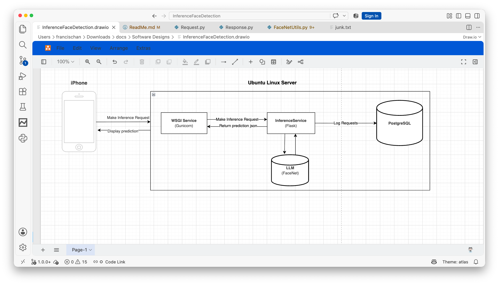
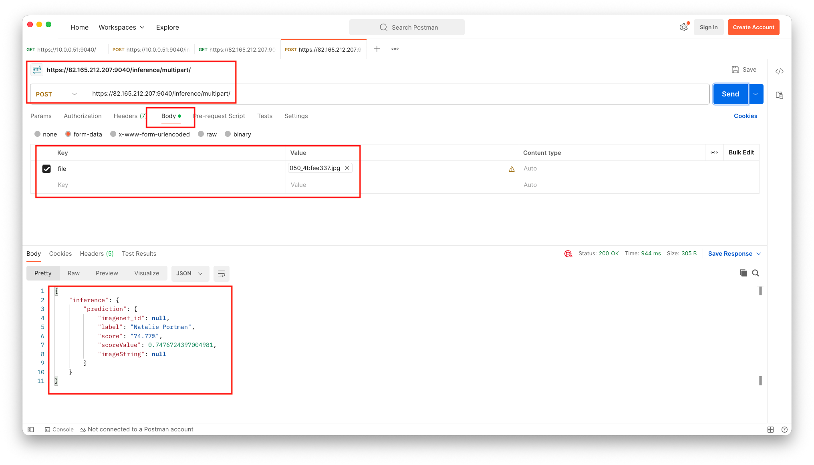

# Face Detection Service (BETA) v1.0
*NOTE: This service is still in beta using a custom self signed certificate.

The "Face Detection Service" is the interface to the backend LLM used to make predictions based on facial recognition. 

Architecture:

Use cases:

    - Search photos.
    - Search videos or a live stream frame by frame.
    - Train the LLM to recognize employees entering a building 
      who would normally need to show ID or use a fob before 
      entering a building.
    - And many more use cases!

The service can be use from a web app, IOS app or any device capable of accessing the service.

For demo purposes the LLM was trained with these famous people's faces:

Angelina Jolie, Brad Pitt, Denzel Washington, Hugh Jackman, Jennifer Lawrence, Johnny Depp, Kate Winslet, Leonardo DiCaprio, Megan Fox, Natalie Portman, Nicole Kidman, Robert Downey Jr, Sandra Bullock, Scarlett Johansson, Tom Cruise, Tom Hanks, Will Smith.

https://www.kaggle.com/datasets/vishesh1412/celebrity-face-image-dataset

The LLM can identify these famous faces from a video, live feed or a photo.

You can try out this service using "Postman" with photos provided in the "TestImages" folder. The service try’s to predict the identity of the uploaded photo and returns a json string with a prediction score for the uploaded image. 

The service logs any uploaded images along with the prediction score for analytics purposes.